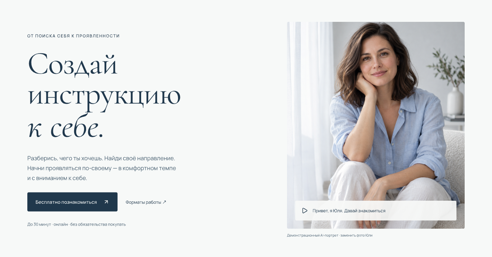

# Сайт Юлии Валишиной

Редактируемый макет в pen.dev и кликабельный прототип сайта коуча. Дизайн «Воздух»: светлый фон, небесные и пудровые акценты, типографика Manrope и Cormorant Garamond.

Текущий этап — дизайн и согласование. Превью использует PNG экранов с активными областями переходов; формы, видео и запись пока представлены макетом.



## Структура

```text
.
├── yuliya-valishina.pen      # Редактируемый источник макета
├── design/
│   ├── README.md            # Экраны, палитра и статусы контента
│   ├── screens.json         # Нумерация и ID экранов pen.dev
│   ├── assets/              # Сгенерированные исходные изображения
│   ├── image-prompts.json   # Промпты изображений
│   ├── exports/             # PNG экранов desktop и mobile
│   └── prototype/           # HTML, CSS, JS и карта переходов
├── docs/
│   ├── brief.md             # Исходное задание пользователя
│   └── architecture.md      # Устройство проекта и порядок обновления
├── scripts/
│   ├── build_preview.py     # Генерация HTML превью
│   └── validate.py          # Проверка экранов, ресурсов и ссылок
└── Makefile                 # Запуск, сборка и проверка
```

Файл `.pen` остаётся в корне: изображения подключены относительно него через `design/assets/`. Открывайте его в pen.dev; для чтения и изменений агентом используйте MCP pen.dev.

## Локальный запуск

Нужны Python 3.10+ и, для коротких команд, Make. Внешних Python- и Node-зависимостей нет.

```sh
make preview
```

Откройте [главную страницу превью](http://127.0.0.1:4173/prototype/index.html). По навигации доступны коучинг, журнал и две статьи. Превью переключает desktop/mobile при ширине 760 px; мобильное меню работает.

Альтернатива без Make:

```sh
python3 -m http.server 4173 --bind 127.0.0.1 --directory design
```

Для другого порта: `make preview PORT=4174`.

## Сборка и проверка

```sh
make build
make check
```

Сборка обновляет HTML по `navigation.json`. Проверка сверяет HTML с генератором, нумерацию экранов, наличие и размеры PNG, переходы и якоря. PNG экспортируются отдельно из pen.dev.

## Экраны макета

| Номера | Экран |
|---|---|
| 00 | Стили и компоненты |
| 01–02 | Главная: desktop и mobile |
| 03–04 | Индивидуальный коучинг: desktop и mobile |
| 05–06 | Журнал: desktop и mobile |
| 07–08 | Единый шаблон статьи: desktop и mobile |
| 09 | Меню и состояния заявки |

На холсте один шаблон статьи. В браузерном прототипе сохранены два варианта его наполнения для проверки переходов из журнала.

## Контент

Исходное задание хранится в [docs/brief.md](docs/brief.md), сведения о демонстрационных материалах — в [design/README.md](design/README.md). Портрет сгенерирован и изображает вымышленную модель. Реальные фото Юлии, контакты, юридические данные и интеграции добавляются перед запуском сайта.
